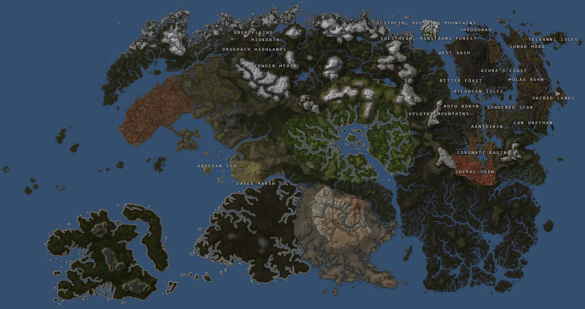

# Elderscrolls Morrowind Mods Map



[MAP](https://tesmap.tesall.club/) | [Mirror](https://tesmap.tesall.ru/)

An interactive web map of Morrowind, Bloodmoon, Tamriel Rebuilt, Project Cyrodiil and Skyrim: Home of the Nords, generated from the plugin files of the game and the mods.

The map data is not in the repository: it is about 3.4 GB of small WebP tiles rendered ahead of time from the landscape and the models of the game and the mods. Build it with the pipeline, as described below.

Parsing is written in Rust, frontend part in typescript.

## Build the map yourself

### What you need

- [Rust](https://rustup.rs) and [Node.js](https://nodejs.org) 20.19 or newer.
- The Elder Scrolls III: Morrowind with Tribunal and Bloodmoon, installed.
- The mods, unpacked anywhere on the disk. Every one is optional except Tamriel Data, which the other mods take their textures and models from:
  - [Tamriel Data](https://www.nexusmods.com/morrowind/mods/44537)
  - [Tamriel Rebuilt](https://www.tamriel-rebuilt.org)
  - [Project Cyrodiil and Skyrim: Home of the Nords](https://www.project-tamriel.com)
  - [Tamriel](https://www.nexusmods.com/morrowind/mods/58155), the land drawn under the three mods above

Disk space for everything, the game aside:

| What | Size |
|---|---|
| Unpacked mods | 3.8 GB |
| Map data, `web/public/data` | 3.4 GB |
| Built site, `web/dist` (a second copy of the data) | 3.4 GB |
| Rust and npm build files | 0.6 GB |
| **Total** | **about 11 GB** |

### 1. Say where the game and the mods are

Copy `paths.example.toml` to `paths.local.toml` in the repository root and put your paths in it. `paths.local.toml` is not committed.

Each mod path is the folder that holds the mod's `.esm` files and its `Textures` and `Meshes` folders. The plugin files that are read, and the mod versions shown on the map, are listed in `plugin-sets.toml`. To leave a mod out, delete its `[[set]]` block there and its id from `backdrop_for` of the Tamriel set; a plugin that is listed but not found stops the build.

### Russian names (optional)

The Map can show its place names in Russian. They come from the Russian releases of the game and the mods: a Russian release keeps the English Cell names inside its plugins and lists the Russian name of each one in a `.cel` file next to the plugin, and the game's Russian plugins also hold the Russian Region names. List the folders with those `.cel` files and plugins under `russian_data_files` in `paths.local.toml`, as in `paths.example.toml`. Without them the Russian Map shows the English names.

### 2. Render the map data

```
cargo run --release --manifest-path pipeline/Cargo.toml -- build
```

A full build of all six Plugin Sets takes about 20 minutes and writes 460,000 tiles. The first run also compiles the pipeline, a few minutes more. 

| Plugin Set | Tiles |
|---|---|
| Morrowind | 0.66 GB |
| Bloodmoon | 0.09 GB |
| Tamriel Rebuilt | 1.9 GB |
| Project Cyrodiil | 0.23 GB |
| Skyrim: Home of the Nords | 0.42 GB |
| Tamriel | 0.13 GB |

To rebuild a part only:

- `--only tr,pc` renders the named Plugin Sets and keeps the tiles of the rest. The ids are in `plugin-sets.toml`.
- `--locations-only` skips the tiles and rewrites the places, regions and doors only, with their Russian names.
- `--area -3,-12,6,-5` renders the Cells inside west,south,east,north only, for trying things out.

The size and the time depend on `cell_pixels` in `plugin-sets.toml`, the pixels per game Cell at the deepest zoom. Halving it from 2048 to 1024 gives roughly a quarter of the size and of the time.

### 3. Look at it

```
cd web
npm install
npm run dev
```

and open the address it prints.

## Licence

The code is under the [MIT licence](./LICENSE). The map tiles and location data are derived from The Elder Scrolls III: Morrowind (Bethesda Softworks) and the mods shown, and are not covered by it.
