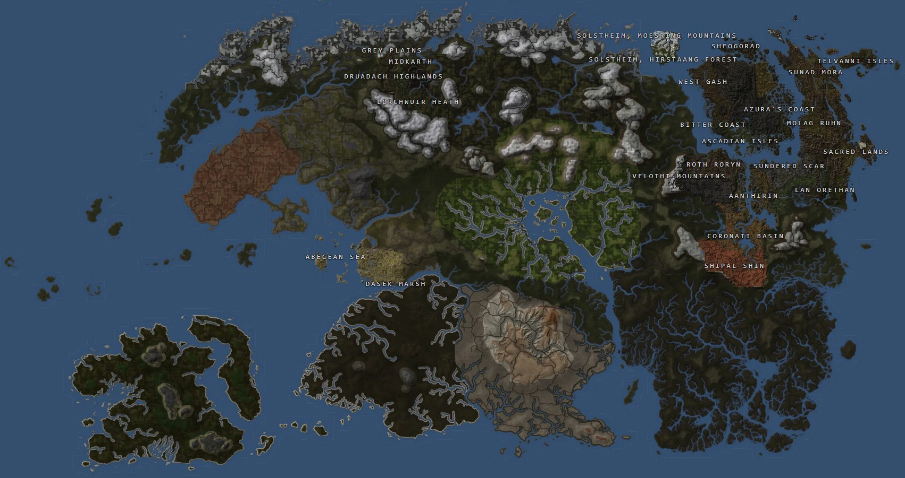

# Elderscrolls Morrowind Mods Map



[MAP](https://tesmap.tesall.club/) | [Mirror](https://tesmap.tesall.ru/)

An interactive web map of Morrowind, Bloodmoon, Tamriel Rebuilt, Project Cyrodiil, Skyrim: Home of the Nords and a few island mods, generated from the plugin files of the game and the mods.

The map data is not in the repository: it is about 1 GB of small WebP tiles rendered ahead of time from the landscape and the models of the game and the mods. Build it with the pipeline, as described below.

Parsing is written in Rust, frontend part in typescript.

## Build the map yourself

### What you need

- [Rust](https://rustup.rs) and [Node.js](https://nodejs.org) 20.19 or newer.
- The Elder Scrolls III: Morrowind with Tribunal and Bloodmoon, installed.
- The mods, unpacked anywhere on the disk. Every one is optional except Tamriel Data, which the other mods take their textures and models from:
  - [Tamriel Data](https://www.nexusmods.com/morrowind/mods/44537)
  - [Tamriel Rebuilt](https://www.tamriel-rebuilt.org)
  - [Project Cyrodiil and Skyrim: Home of the Nords](https://www.project-tamriel.com)
  - [Tamriel](https://www.nexusmods.com/morrowind/mods/58155), the land drawn under the three mods above
  - [Solstheim Tomb of the Snow Prince](https://www.nexusmods.com/morrowind/mods/46810), the `000 Core` folder
  - [Wyrmhaven](https://www.nexusmods.com/morrowind/mods/42933)
  - [White Wolf of Lokken](https://www.nexusmods.com/morrowind/mods/27306)
  - [Lyithdonea: The Azurian Isles](https://www.nexusmods.com/morrowind/mods/43749), with [OAAB_Data](https://www.nexusmods.com/morrowind/mods/49042), the textures and models it uses

Disk space for everything, the game aside:

| What | Size |
|---|---|
| Unpacked mods | 5.9 GB |
| Map data, `web/public/data` | 1.0 GB |
| Built site, `web/dist` (a second copy of the data) | 1.0 GB |
| Rust and npm build files | 0.6 GB |
| **Total** | **about 8.5 GB** |

### 1. Say where the game and the mods are

Copy `paths.example.toml` to `paths.local.toml` in the repository root and put your paths in it. `paths.local.toml` is not committed.

Each mod path is the folder that holds the mod's `.esm` files and its `Textures` and `Meshes` folders. The plugin files that are read, and the mod versions shown on the map, are listed in `plugin-sets.toml`. To leave a mod out, delete its `[[set]]` block there and its id from `backdrop_for` of the Tamriel set; a plugin that is listed but not found stops the build.

### Russian names (optional)

The Map can show its place names in Russian. They come from the Russian releases of the game and the mods: a Russian release keeps the English Cell names inside its plugins and lists the Russian name of each one in a `.cel` file next to the plugin, and the game's Russian plugins also hold the Russian Region names. List the folders with those `.cel` files and plugins under `russian_data_files` in `paths.local.toml`, as in `paths.example.toml`. Without them the Russian Map shows the English names.

### 2. Render the map data

```
cargo run --release --manifest-path pipeline/Cargo.toml -- build
```

A full build of all ten Plugin Sets takes about 12 minutes and writes 162,000 tiles. The first run also compiles the pipeline, a few minutes more. 

| Plugin Set | Tiles |
|---|---|
| Morrowind | 0.15 GB |
| Bloodmoon | 0.03 GB |
| Tamriel Rebuilt | 0.45 GB |
| Project Cyrodiil | 0.05 GB |
| Skyrim: Home of the Nords | 0.09 GB |
| Tamriel | 0.13 GB |
| Solstheim Tomb of the Snow Prince | 0.03 GB |
| Wyrmhaven | 0.01 GB |
| White Wolf of Lokken | 0.005 GB |
| Lyithdonea: The Azurian Isles | 0.06 GB |

To rebuild a part only:

- `--only tr,pc` renders the named Plugin Sets and keeps the tiles of the rest. The ids are in `plugin-sets.toml`.
- `--locations-only` skips the tiles and rewrites the places, regions and doors only, with their Russian names.
- `--area -3,-12,6,-5` renders the Cells inside west,south,east,north only, for trying things out.

The build also writes the transport data from the same plugins. To update only the transport data, without rendering the terrain again, run:

```
cargo run --release --manifest-path pipeline/Cargo.toml -- transport
```

#### Transport

Everything the transport layer shows is read from the plugins of the enabled Plugin Sets, applied in load order:

- **Carriers.** Characters and creatures with travel destinations, and the routes between where they stand and where they take the player. A carrier inside an interior is placed where the doors lead out of it.
- **Which mods a carrier needs.** A mod's start script sets its "installed" global variable to 1, such as `T_Glob_Installed_TR`. A carrier whose script enables or disables it on such a variable is shown only with that mod, or goes away with it. A script that moves a carrier when a mod is installed moves it on the Map too, as Project Cyrodiil does with its shipmaster in Ebonheart when Tamriel Rebuilt is on.
- **Carriers that come and go.** A carrier whose script enables or disables it on anything else, such as the stage of a quest, is marked as depending on the game.
- **Gates.** Activators whose script moves the player while the player carries an item, such as the propylons. The route names the item it needs.
- **Transport in dialogue.** Answers in the configured dialogue topics that move the player, directly or through a script they start, such as the journey to Mournhold.
- **Intervention markers** for Almsivi and Divine Intervention.

The plugins do not say everything, so the `[transport]` table at the end of `plugin-sets.toml` adds:

- the transport mode of each carrier class, and of the few carriers whose class does not tell, such as the sky lanterns;
- the items that make an activator a gate, such as the propylon indexes;
- the dialogue topics whose answers are transport rather than a quest event;
- anchors: the point on the Map for a place that is only interiors, such as Mournhold.

The build lists the carriers it leaves out because their class has no mode. To see what the rules are checked against, run `transport-audit --out report.json`: it writes the carriers with their classes, the dialogue answers that move the player, the scripts that toggle or move actors, and the "installed" globals.

The lines are schematic and do not show the way actually travelled. A Map built before transport support, or with transport data of another version, keeps working without the transport layer.

The route planner under Transport in the legend finds up to three ways between named locations or points picked on the Map, using the enabled Plugin Sets and transport modes. It counts walking as a straight line, up to 8 cells to reach a stop and 1.5 cells between stops. It does not account for roads, terrain, water, travel costs, quest progress or items the player carries; the conditions of each route are shown where the plugins tell them.

The Intervention section shows the Almsivi and Divine Intervention markers of the enabled Plugin Sets. Choose a named location or a point on the Map to see where each would take the player, and switch on either kind of marker to draw it. The destination is found as OpenMW finds it from the exterior: the marker in the nearest square ring of Cells around the point, ties broken along the ring from its south-west corner. Starting inside an interior, blocked teleportation and changes made while playing can give a different result. Mournhold's markers are inside, so they are not on the Map.

The size and the time depend on `cell_pixels` in `plugin-sets.toml`, the pixels per game Cell at the deepest zoom. It is 1024; doubling it to 2048 gives sharper textures up close at roughly four times the size and three times the time.

### 3. Look at it

```
cd web
npm install
npm run dev
```

and open the address it prints.

## Licence

The code is under the [MIT licence](./LICENSE). The map tiles and location data are derived from The Elder Scrolls III: Morrowind (Bethesda Softworks) and the mods shown, and are not covered by it.
